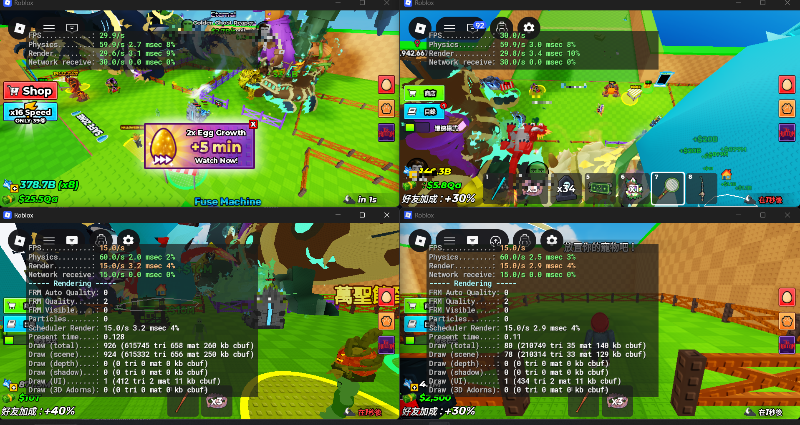

<div align="center">


# MultiRoblox

**Run as many Roblox accounts as you want, all at once, on Windows.**

[](https://github.com/sjrom/MultiRoblox-RAM/releases)
[](https://tauri.app/)
[](LICENSE)
[](https://github.com/sjrom/MultiRoblox-RAM/releases)

<br>



</div>

---

## Quick start

No installer needed. Grab the exe from [**Releases**](https://github.com/sjrom/MultiRoblox-RAM/releases) and run it.

Or build it yourself:

```bash
git clone https://github.com/sjrom/MultiRoblox-RAM.git
cd MultiRoblox-RAM/MultiRoblox
build.bat
```

> Requires the [Rust toolchain](https://rustup.rs). The finished exe lands in `dist\release_<version>\MultiRoblox_v<version>.exe` (for example, `dist\release_1.2.11\MultiRoblox_v1.2.11.exe`). Rebuilding removes the previous output directory for that version; other versions are kept.

To bump the app version, edit only `[package].version` in `MultiRoblox/src-tauri/Cargo.toml`, then run `build.bat`. Tauri, the release directory, and the release EXE filename use that version. Cargo updates `Cargo.lock` during the build; commit that generated change along with the version bump.

### 🛡️ Windows Defender Exclusion (False Positive Prevention)

Because MultiRoblox extracts its unsigned helper (`RobloxNative.exe`) to `%APPDATA%\multiroblox` and closes Roblox's singleton mutex/event handles across processes, Windows Defender's behavioral ML engine may falsely flag it (`Behavior:Win32/DefenseEvasion.A!ml`). `Add-MpPreference` natively supports `*` wildcards in both `-ExclusionPath` and `-ExclusionProcess`, so a single rule covers `MultiRoblox_v1.2.X.exe` across all versions. Run this command once in an **Administrator PowerShell**:

**中文說明（防止 Windows Defender 誤判隔離）：**
由於 MultiRoblox 會在啟動時將未簽章的輔助程式（`RobloxNative.exe`）釋放至 `%APPDATA%\multiroblox`，並跨處理序關閉 Roblox 的單開限制 Handle，Windows Defender 的機器學習行為偵測可能會誤判為 `Behavior:Win32/DefenseEvasion.A!ml`。`Add-MpPreference` 的 `-ExclusionPath` 與 `-ExclusionProcess` 皆原生支援 `*` 萬用字元，請以**系統管理員身分**開啟 PowerShell 執行以下指令一次，即可自動涵蓋所有 `MultiRoblox_v1.2.X.exe` 版本：

```powershell
Add-MpPreference -ExclusionPath "$env:USERPROFILE\Desktop\MultiRoblox-RAM", "$env:USERPROFILE\Desktop\MultiRoblox-RAM\MultiRoblox\dist\release_*\MultiRoblox_v*.exe", "$env:USERPROFILE\Desktop\MultiRoblox_v*.exe", "$env:APPDATA\multiroblox" -ExclusionProcess "MultiRoblox_v*.exe", "MultiRoblox.exe", "RobloxNative.exe"
```

---

## Features

### 👤 Accounts
- Launch as many accounts side by side as you want, and auto-align running windows into a 2-column screen grid (`1x2`, `2x2`, `3x2`, ...) with one click
- Sign in through a real Roblox login window, or paste a cookie directly
- Set a game ID, invite link, or private server link per account so it launches straight there
- Per-account target FPS cap (15, 30, or 60 FPS; default 30 FPS) applied to Roblox's global client settings on launch
- Nicknames, search, and filtering across all saved accounts
- Cookies encrypted with AES-256-GCM, stored locally. Nothing leaves your device
- Auto-relaunch on unexpected disconnect, back into the same game (crash-loop protected)
- Right-click a running account to set its process priority (Realtime down to Low)

### 📦 Groups
- Bundle accounts into groups (farm squad, trading alts, etc.)
- Launch or kill an entire group at once, with a shared or per-account game target

### 🎚️ Mixer
- Render quality and volume for all running instances, one panel
- Graphics quality writes to Roblox's fast flags
- Works with vanilla Roblox and Bloxstrap / Froststrap / Voidstrap / Fishstrap
- Live, per-instance OS-level volume control
- Kill all instances with one click

### 📸 Tracking
- Automated per-account screenshots sent to a Discord webhook on a timer
- Outline one or more capture spots per account, or grab the full window

### 📊 Charts
- Browse top playing now, top rated, and top earning games
- Search and launch any game straight from the charts page

### 🎲 Generator
- Generate Roblox accounts via a [bloxgen.net](https://bloxgen.net/) API key

### ⚙️ Settings
- **General**: multi-instance status, anti-AFK, relaunch-on-disconnect
- **Performance**: RAM trim (manual or automatic on an interval), lower CPU priority once multiple accounts are running, force a specific rendering engine (Direct3D 11/9, OpenGL, Vulkan) via Fast Flags
- **Data & Privacy**: custom encryption key (AES-256-GCM) or OS-native DPAPI (Windows keychain), clear all accounts
- **Themes**: light/dark and several accent themes
- **Sounds**: custom UI sound profiles with volume control and upload-your-own support

### 🕹️ Anti-AFK
- Taps a benign key into every open Roblox window on a configurable interval without flashing background or minimized windows, so the idle kick never fires

### 📜 Logs
- Real-time log viewer with in-page search (Ctrl+F)

---

## How it works

Roblox prevents multiple instances by holding a Windows mutex. MultiRoblox grabs that mutex first through a lightweight native helper (`RobloxNative.exe`, written in C#), so Roblox opens a fresh instance every time. Each account gets its own auth ticket before launch, so they all sign in as different accounts.

Login opens a native, chromeless window (no external browser involved) that reads the session cookie directly once you sign in.

If the native helper isn't shipped with a build, it compiles from the bundled source using the .NET Framework `csc.exe` already on every Windows machine.

---

## Disclaimer / 免責聲明

### English

This project is an unofficial modified version maintained by [sjrom](https://github.com/sjrom), based on the original project by [PookiePepelsss](https://github.com/PookiePepelsss/MultiRoblox-RAM). It is not developed, sponsored, endorsed, or supported by Roblox Corporation. Roblox and related trademarks belong to their respective owners.

Users must comply with the [Roblox Terms of Use](https://en.help.roblox.com/hc/en-us/articles/115004647846-Roblox-Terms-of-Use), [Community Standards](https://en.help.roblox.com/hc/en-us/articles/203313410-Roblox-Community-Standards), and the rules of each experience. This project does not guarantee that its features comply with Roblox policies or that using it will avoid account restrictions, suspension, or other enforcement actions. Do not use it for cheating, ban evasion, unauthorized access, or other prohibited activities.

This disclaimer does not grant permission from Roblox or override applicable terms or law. Report issues with this fork to [this repository](https://github.com/sjrom/MultiRoblox-RAM/issues), rather than requesting support from the original author or Roblox.

### 繁體中文

本專案為 [sjrom](https://github.com/sjrom) 維護的非官方修改版本，源自 [PookiePepelsss 的原始專案](https://github.com/PookiePepelsss/MultiRoblox-RAM)，並非由 Roblox Corporation 開發、贊助、認可或提供支援。
Roblox 名稱及相關商標屬其各自權利人所有。

使用者必須遵守 [Roblox 使用條款](https://en.help.roblox.com/hc/en-us/articles/115004647846-Roblox-Terms-of-Use)、[社群規範](https://en.help.roblox.com/hc/en-us/articles/203313410-Roblox-Community-Standards)及各遊戲規則。
本專案不保證其功能符合 Roblox 政策，也不保證使用後不會受到帳號限制、停權或其他處置。請勿用於作弊、規避停權、未經授權存取或其他違規用途。

本聲明不代表取得 Roblox 的許可，亦不取代適用條款或法律。
此 fork 的問題請向[本 repository](https://github.com/sjrom/MultiRoblox-RAM/issues) 回報，請勿向原作者或 Roblox 尋求此修改版本的技術支援。

---

## License

Free to use, modify, and share. You may not sell it, and any copy or fork must credit **pookiepepelss** as the original author.

See [LICENSE](LICENSE) for the full text.

<div align="center">

Not affiliated with Roblox Corporation.

</div>
